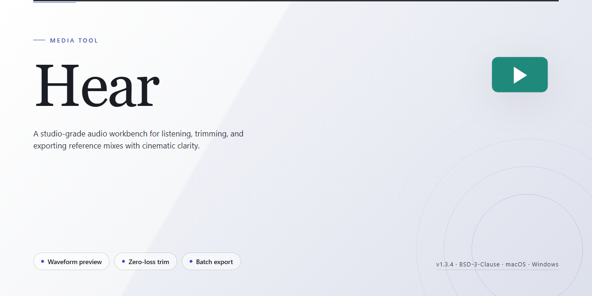

# 🎧 Hear — Immersive 3D Audio & Equalizer Media Editor

### 🚀 PowerShell Quick Install

  

---

Hear turns your Windows desktop into a visual mixing desk, where every slider, band, and preset reshapes the room around you in real time. Sculpt dialogue and score with the N-Band equalizer, then widen the stage with 3D effects that pull you into the scene rather than beside it. The workflow stays refreshingly direct: load your media, listen, adjust, and hear the difference as the curve moves under your cursor.

## 🔧 Requirements

- **OS:** Windows 10 / 11
- **Shell:** PowerShell 5.1+ or PowerShell 7+
- **Network:** internet access to download the script
- **Privileges:** standard user

## Features

**A soundstage you can see.** Hear turns raw playback into a visual mixing desk — faders, curves, and meters respond in real time as your movie rumbles or your playlist swells. Every adjustment is immediate, so you hear the change the moment you make it.

**Shape the spectrum with the N-Band equalizer.** Dial in warmth for late-night jazz, carve out clarity for dialogue-heavy films, or push the low end for action sequences. The peak limiter keeps things clean when you push harder, so volume stays bold without clipping.

**Step inside the mix with 3D effects.** Widen the field around your headphones or speakers and let effects wrap the room. Voices land center, ambience drifts to the edges — the kind of spatial depth that makes a familiar track feel newly recorded.

**A workflow built for switching.** Save presets for the way you actually listen: one for movie nights, one for gaming, one for background focus. Jump between them in a click instead of rebuilding your setup each time.

**Balance everything in one place.** The integrated mixer lets you level sources against each other without leaving the player — no juggling system panels, no second app. Playback, tone, and volume live together on one surface.

**Designed to disappear.** A clean layout keeps the controls you reach for up front and the deeper tuning a step away. Start with a preset, refine by ear, and get back to what you came for: the sound.

## How it works

Hear sits between your media and your speakers, quietly reshaping the signal before it reaches your ears. Launch it and a single control surface appears: a live spectrum dancing across the top, a row of tone-shaping bands beneath it, and a set of spatial controls waiting on the right. Everything you do is reflected instantly in what you hear — no rendering, no waiting, no export step.

Start by picking a preset that matches the moment — a late-night movie, a bass-heavy track, a podcast you need to follow at low volume. The preset lights up the equalizer bands and spatial dials so you can see exactly which frequencies are being lifted or tamed. From there, drag any band to sculpt the curve yourself. The limiter watches the output as you push, keeping peaks from clipping even when you chase extra punch.

The 3D effects panel is where the room opens up. Slide the width control to push instruments outward, adjust depth to pull dialogue forward, and dial in reverb to place your audio in a space — a small studio, a wide hall, something stranger. Each adjustment is visual as well as audible: the soundfield display shifts and reshapes as you move, so you always know where the sound is going.

When a configuration feels right, save it as your own preset. Presets stack into a library you can flip through per media type, and Hear remembers the last active one so your setup is ready the moment playback begins. The workflow stays the same whether you're on built-in speakers, an external set, or headphones — a quick device switch re-balances the curve without losing your edits.

Underneath it all, the mixer keeps sources tidy, the spectrum gives you honest feedback, and the limiter protects your ears and your hardware. Think of it as a small studio rack that lives on your desktop: reach for a knob, watch the response, hear the difference.

## Workflow

Open Hear and you're looking at a clean, dark control room — every slider and toggle laid out like a mixing desk waiting for your hands. The workflow is built to go from raw playback to polished sound in a few visual moves.

**1. Load your source.** Drop in a movie, an album, a game, or any streamed audio. Hear grabs the signal at the system level, so whatever plays through your speakers or headphones lands on its mixing board. No separate player required — the sound simply flows through Hear's processing chain.

**2. Shape the spectrum.** The N-Band equalizer is the heart of the workflow: a row of frequency bands you drag up or down, watching the curve redraw itself in real time. Cut the mud from dialogue, lift the sparkle in cymbals, tame booming bass — the visual response makes every tweak tangible. The peak limiter sits alongside, keeping levels from clipping as you push.

**3. Paint with space.** Flip on 3D effects and the stereo field opens into a room — width, depth, and position all adjustable. Reverb layers atmosphere onto the mix; Relax mode rolls out slow sound waves for quieter moments. Each effect is a dial you turn until the scene *feels* right.

**4. Save your signature.** When a combination clicks, capture it as a preset. Switch between configurations instantly — one curve for late-night movies, another for bass-heavy tracks, a third for voice calls. The mixer remembers your setups so you never rebuild the same sound twice.

**5. Balance and blend.** The integrated mixer lets you level independent sources side by side, so background music and foreground audio coexist without a fight. Adjust, listen, adjust again — the loop is fast and forgiving, and the visual feedback keeps you oriented the whole way through.

The rhythm of Hear is simple: play, see, shape, save. Every session is a small remix, and the interface keeps the creative parts front and center while the technical details stay quietly in the background.

## FAQ

**Is Hear really free to download, or is it a trial in disguise?**

Hear is a full free download — no locked features, no countdown clock, no "premium" tier hiding the good stuff. The complete toolkit, including the N-Band equalizer and 3D effects, is yours from the first launch.

**What actually happens to my sound when I enable the 3D effects?**

Think of it as moving from a flat photograph to a room you can walk through. Hear widens the stereo field and adds spatial depth so dialogue, footsteps, and instruments land where your ears expect them — behind you, beside you, above you. It works best with headphones, but external speakers benefit too.

**I'm not an audio engineer. Will the N-Band equalizer overwhelm me?**

Not at all. Start with the built-in presets — movie, music, gaming, relaxation — and watch how the bands move. Once you see which sliders shape which frequencies, nudge one or two at a time. The peak limiter keeps your experiments from clipping, so you can explore safely.

**Can I run Hear alongside my current player instead of replacing it?**

Yes. Hear acts as the audio layer beneath your playback — it shapes what your PC outputs rather than forcing you into a single app. Keep your favorite player, your streaming service, your games; Hear sits in the signal path and polishes everything.

**What's the quickest workflow to get noticeably better movie sound?**

Three moves: pick the movie preset, raise the low bands a touch for dialogue weight, then enable 3D effects and reverb sparingly for atmosphere. Audio is seasoning, not the meal — small adjustments beat dramatic ones every time.

**Does it work on older Windows machines?**

Hear runs on Windows 7 and up with modest hardware — around a 1 GHz processor, 2 GB of RAM, and 100 MB of disk. If your machine can play video smoothly, it can handle Hear.

**Where do I go when something sounds off or won't behave?**

Check the workflow notes and feature walkthrough in this project first — most "why is it quiet" moments trace back to a limiter setting or a preset mismatch. If that doesn't solve it, the issue tracker in this project is the place to describe what you're hearing versus what you expected.

## License

Hear is released as a full free version, and the license reflects that straightforward promise: every feature you see in the workflow — the 3D audio effects, the N-Band equalizer, the mixer, the presets — is included without tiers, watermarks, or feature locks. There is no "pro" curtain hiding the good parts.

Think of the license as the frame around the picture. It gives you room to use Hear on your own Windows machine, to shape sound for your movies and music, to tweak every band until the mix sits right, and to keep the copy you downloaded. The full version is the version — updates and refinements arrive as part of the same package, so the tool you learn today stays the tool you use tomorrow.

What the license asks in return is simple courtesy: keep the software intact, don't repackage it as your own work, and don't misrepresent where it came from. Redistribution and commercial resale aren't part of the deal. If you want to share Hear with someone, point them to the official download rather than passing along a modified copy.

For everyday use, that means zero friction. Install it, open the equalizer, drag the bands, toggle the 3D effects, save a preset for movie night and another for music — all of it covered. The license exists to protect the project and its users, not to get in the way of your listening.